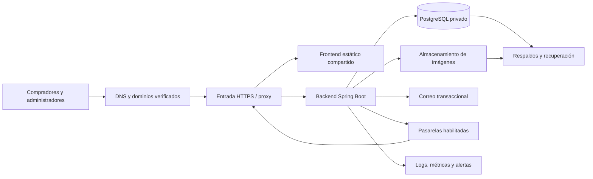

# UvoStore: plan de profesionalización y puesta en producción

**Fecha:** 7 de octubre de 2026.  
**Base revisada:** repositorio local, commit `b64ac00`, más el estado de trabajo disponible.  
**Estado del documento:** propuesta técnica y lista de aceptación; las tareas pendientes no se consideran implementadas por aparecer aquí.  
**Destinatarios:** responsable de producto, ingeniería, operaciones y equipo que habilita tiendas.  
**Actualización del 13 de octubre de 2026:** el e-commerce pasa a ser un módulo de UvoPOS, que es el maestro del catálogo, los precios y el stock, y se desplegará en su plataforma. Cambian §2, §3, §4.1, §5.1 (PROD-01 y PROD-12), §7.1, §9.2 y §13, y se añaden §5.4 (tareas `POS-1` a `POS-7`) y §6.5. El orden de ejecución y la dificultad de cada tarea están en `docs/orden-tareas-produccion.md`, que es un documento local: `docs/` está en `.gitignore`.

## 1. Dictamen y alcance

UvoStore tiene una base funcional considerable: backend, storefront, panel administrativo, aislamiento por tienda, permisos, integraciones de pago, migraciones y pruebas automatizadas. Puede evolucionar a producción manteniendo su arquitectura de monolito modular con un frontend compartido.

**No se debe declarar listo para un lanzamiento comercial general con la evidencia disponible.** Faltan infraestructura reproducible, validación del recorrido completo por dominio, recuperación demostrada, operación observable y cierre de funciones que hoy ofrecen enlaces o integraciones incompletos. Crear una tienda `ACTIVE` en la base de datos no demuestra que un comprador pueda visitarla y completar una compra por HTTPS.

La preparación profesional se medirá por resultados verificables: despliegues repetibles, datos recuperables, aislamiento comprobado, pagos conciliables, funciones completas y personas responsables de atender incidentes. Este plan no exige microservicios, Kubernetes ni una reescritura para alcanzar esos resultados.

### 1.1 Qué se revisó y qué queda por demostrar

Se revisaron los flujos de alta, resolución de tiendas, configuración, seguridad, CI y releases, almacenamiento, correo, pagos, eventos, invitaciones y rutas del frontend. Se consultó documentación oficial para fundamentar recomendaciones de operación.

En la evaluación inmediatamente anterior se ejecutó `StoreOnboardingTest`: **7 pruebas aprobadas, 0 fallos y 0 errores**. Ese resultado valida el alta y acceso al panel en integración; no certifica DNS, HTTPS, navegador, correo ni pasarelas reales.

Para elaborar este documento no se ejecutó nuevamente la suite completa, una prueba de carga, un pentest, un despliegue ni una restauración. Tampoco se inspeccionó una cuenta de hosting o la configuración remota de GitHub. Por tanto:

- «Implementado» significa que existe evidencia en el código; su operación real debe validarse en staging.
- «Pendiente confirmado» corresponde a una carencia identificada en código o configuración del repositorio.
- «Por verificar» significa que no hay evidencia suficiente para afirmar su cumplimiento o ausencia fuera del repositorio.
- Las cifras de capacidad, SLO, RPO y RTO de este documento son **objetivos propuestos**, no mediciones ni compromisos ya acordados.

Los hallazgos históricos `C1`, `A1`, `F01`–`F24` no se reabren automáticamente. Los identificadores de este plan usan el prefijo `PROD-` y son independientes de las auditorías anteriores. No se utilizarán porcentajes antiguos de cobertura como si describieran el estado actual.

## 2. Estado actual y consecuencias para el lanzamiento

| Área                                  | Evidencia actual                                                                                                                                           | Consecuencia                                                                                                |
|---------------------------------------|------------------------------------------------------------------------------------------------------------------------------------------------------------|-------------------------------------------------------------------------------------------------------------|
| Alta de tiendas                       | Formulario de plataforma y API crean tienda activa, propietario y rol con permisos                                                                         | El aprovisionamiento funcional existe; faltan entrega de URL y verificación pública de la tienda            |
| Multi-tenancy                         | Resolución por dominio y slug; JWT ligado a tienda; pruebas de aislamiento                                                                                 | Conservar las garantías y probarlas también detrás del proxy y caché reales                                 |
| Enlaces públicos                      | `APP_FRONTEND_URL` global en recuperación, invitaciones y retorno final de Webpay                                                                          | Un único valor no representa los dominios de todas las tiendas                                              |
| Invitación de administradores         | Backend y correo implementados; falta `/admin/aceptar-invitacion`                                                                                          | La invitación actual no se completa desde el navegador                                                      |
| Cuenta de comprador                   | API de cuenta y direcciones; falta interfaz; se envía enlace a `/cuenta/activar`                                                                           | Completar el recorrido o retirar temporalmente la oferta y el envío de esa invitación                       |
| Seguridad                             | Permisos, revocación JWT, limitación de intentos, HMAC, validación de imágenes y cifrado                                                                   | Base existente; faltan controles operativos y revisión de la exposición final                               |
| Pagos                                 | Validación de importe, control de transiciones, conciliación e intención persistente de reembolso                                                          | No reemplaza la homologación de cada pasarela, cuenta comercial y callback público                          |
| Stock y efectos posteriores al commit | Actualizaciones condicionales e idempotencia; eventos locales en memoria                                                                                   | La consistencia debe recuperarse también después de una caída abrupta del proceso                           |
| Correo                                | SMTP con timeouts; sin configuración omite el envío; los errores se registran                                                                              | No hay evidencia de entrega, reintento durable ni supervisión operativa suficientes                         |
| Envíos                                | Tarifas y zonas implementadas; Chilexpress con contrato pendiente de validar; Correos es un placeholder                                                    | Lanzar solo modalidades comprobadas; no presentar esas integraciones como listas                            |
| Integración con UvoPOS                | Sincronización de catálogo y stock, webhooks firmados y notificación de órdenes implementados, pero apagados (`POS_ENABLED=false`); contrato sin confirmar | El POS es el maestro del catálogo, los precios y el stock: la integración entra al lanzamiento (§5.4, §6.5) |
| Archivos                              | Drivers local y S3; validación de formato                                                                                                                  | Provisionar persistencia, permisos, respaldo y prueba de recuperación                                       |
| Base de datos                         | PostgreSQL, Flyway hasta V22, validación del esquema                                                                                                       | Definir operación, permisos mínimos, migración controlada y restauración                                    |
| CI y release                          | Backend `verify`, frontend lint/test/build, Qodana y artefactos de release                                                                                 | Publicar un release de GitHub no despliega ni valida producción                                             |
| Observabilidad                        | Logs, integración opcional con Sentry y `/actuator/health`                                                                                                 | Faltan evidencia de alertas, métricas de negocio y respuesta a incidentes                                   |
| Escalamiento                          | Cachés de autenticación, rate limiting y antirreplay locales                                                                                               | No habilitar varias réplicas sin revisar estas garantías                                                    |
| Documentación comercial               | Páginas legales genéricas compartidas                                                                                                                      | Ajustar contenido y responsabilidades reales por tienda antes de publicar                                   |

Referencias de código y documentos en la sección 14.

## 3. Alcance recomendado de la primera versión comercial

Propuesta inicial: tiendas chilenas, CLP, compras como invitado, un backend activo, PostgreSQL administrado, almacenamiento persistente, correo transaccional y únicamente medios de pago y envío validados. La infraestructura es la de la plataforma de UvoPOS (§4.1); su dimensionamiento depende del volumen y de los requisitos de disponibilidad.

Debe existir un acuerdo de alcance que indique qué se vende y qué no está disponible. Una función diferida se oculta o deshabilita en sus puntos de entrada, API y correos cuando corresponda. Un texto de «próximamente» no vuelve seguro un flujo de cobro o una integración accesible.

| Capacidad                                     | Condición para la primera salida                                                                                             |
|-----------------------------------------------|------------------------------------------------------------------------------------------------------------------------------|
| Crear tienda y entregar acceso al propietario | Obligatoria y verificada por HTTPS                                                                                           |
| Catálogo, carrito, checkout y seguimiento     | Obligatorios para la modalidad de venta ofrecida                                                                             |
| Pago manual                                   | Puede ser la única modalidad inicial si existe un proceso real de conciliación, vencimiento y confirmación                   |
| Stripe, Webpay o MercadoPago                  | Obligatorio validar cada uno que se habilite; no es necesario lanzar los tres juntos                                         |
| Tarifas de envío propias o retiro             | Alternativa inicial si coincide con la operación del comerciante y funciona de extremo a extremo                             |
| Chilexpress y Correos de Chile                | Diferibles; ocultar los no homologados y rechazar su activación                                                              |
| Invitación de administradores                 | Completar la pantalla y recuperación de invitaciones; el formulario actual ofrece esta función                               |
| Cuentas de compradores                        | Diferibles; suspender los correos y entradas que prometen una cuenta utilizable hasta cerrar todo el flujo                   |
| Integración con UvoPOS                        | Obligatoria: el POS es el maestro del catálogo, los precios y el stock, y cada venta web debe quedar registrada en él (§6.5) |
| Emisión de documentos por el POS              | Opcional por tienda; la que no la use necesita un proceso externo acordado. No prometer emisión automática sin validación    |
| Varias réplicas y alta disponibilidad         | Diferibles para un piloto con disponibilidad y recuperación explícitamente acordadas                                         |

La creación de la tienda no carga productos, no configura una cuenta comercial de pagos y no demuestra cobertura de despacho. La habilitación técnica y la preparación comercial de cada tienda deben registrarse por separado.

## 4. Arquitectura de producción inicial



### 4.1 Decisiones que se deben registrar antes de contratar y desplegar

Crear registros breves de decisión arquitectónica —ADR— con contexto, opciones, elección, consecuencias y responsable:

| Decisión                                                   | Entregable                                                                           |
|------------------------------------------------------------|--------------------------------------------------------------------------------------|
| Proveedor, región, presupuesto y soporte                   | Presupuesto mensual desglosado y responsables de las cuentas                         |
| Disponibilidad, pérdida de datos y recuperación tolerables | SLO, RPO y RTO aceptados por negocio                                                 |
| Forma de ejecutar el backend                               | Contenedor o servicio de sistema reproducible, supervisado y con límites de recursos |
| Dominio de plataforma y dominios propios                   | Procedimiento de DNS, prueba de propiedad, TLS y renovación                          |
| Almacenamiento de imágenes                                 | Volumen durable respaldado o bucket S3 compatible con política de acceso documentada |
| Correo y pasarelas iniciales                               | Cuentas verificadas, responsables y separación de credenciales por ambiente          |
| Alcance de cuentas de comprador, POS y transportistas      | Funciones habilitadas y condiciones para activar las diferidas                       |

Los costos deben incluir cómputo, base de datos, respaldos, transferencia, imágenes, correo, observabilidad, DNS, contingencia y atención operativa. No estimar rentabilidad usando solo el costo del servidor. Dimensionar con mediciones de staging antes de cerrar capacidad.

**Decidido el 13 de octubre de 2026:** el e-commerce se despliega en la plataforma de UvoPOS, un SaaS en la nube con infraestructura en producción que mantiene el mismo equipo. Se comparte la infraestructura —proxy, servidor PostgreSQL, respaldos, gestión de secretos, correo, observabilidad y pipeline—, pero el e-commerce sigue siendo **un servicio y una base de datos propios**: base y rol separados en el mismo servidor, e integración con el POS por contrato HTTP sobre red privada (§6.5). Falta registrar el ADR y resolver lo que la plataforma no tenía: subdominio por tienda, dominios propios, entrada pública para compradores y webhooks de pasarelas. Si la plataforma despliega por defecto con varias réplicas o con rolling, el e-commerce va con una sola réplica y sin solapamiento hasta cerrar PROD-26.

### 4.2 Ambientes y red

Mantener desarrollo, CI, staging y producción separados. Staging debe reproducir proxy, HTTPS, rutas, almacenamiento y comportamiento de jobs de producción, con datos sintéticos o anonimizados y credenciales de prueba.

La base de datos y el puerto del backend no deben quedar accesibles directamente desde Internet. Publicar solo la entrada HTTPS necesaria. Administrar infraestructura mediante identidades individuales, MFA y permisos mínimos; disponer de un acceso de emergencia controlado.

Servir `/api/**` desde el backend y las rutas de la SPA desde su `index.html`. Configurar explícitamente `/uploads/**` cuando se use almacenamiento local. No enviar una llamada API inexistente al HTML de la SPA. Probar recarga directa en `/shop`, productos, `/admin/login` y enlaces de recuperación.

El proxy debe conservar el host validado que identifica a la tienda: el valor predeterminado de una configuración de proxy no debe sustituirlo por el host interno del backend. La documentación de [NGINX sobre cabeceras hacia el upstream](https://nginx.org/en/docs/http/ngx_http_proxy_module.html#proxy_set_header) fundamenta esta configuración; debe adaptarse al proxy elegido.

### 4.3 DNS, TLS y cachés

- Configurar dominio de plataforma y subdominios; si se usa wildcard, comprobar DNS y certificado para esos nombres. El dominio raíz requiere su tratamiento correspondiente.
- Verificar propiedad de dominios propios antes de asignarlos y emitir certificados. Registrar estados como pendiente, verificado, certificado y operativo en el procedimiento o implementación elegida.
- Automatizar renovación, alertar por vencimiento y definir retirada o cambio de dominio sin dejar asociaciones ajenas activas.
- Rechazar hosts desconocidos en la entrada. El resolver solo acepta como fallback `<slug>.<dominio-plataforma>` exacto (PROD-05a; antes tomaba el primer segmento de cualquier hostname); el proxy y la política de dominios deben limitar los nombres realmente admitidos.
- Redirigir HTTP a HTTPS. Aplicar HSTS cuando todos los nombres afectados estén preparados; no activar `includeSubDomains` o preload sin revisar ese alcance.
- Separar caché por hostname y URL. Nunca compartir respuestas autenticadas, pedidos o configuración de tiendas bajo una clave de caché común.
- Dar larga duración a assets con hash; permitir actualización o revalidación de `index.html`. Comprobar que un despliegue no deja HTML apuntando a chunks eliminados.

**Aceptación:** dos tiendas con contenido diferente se visitan simultáneamente, con caché habilitada, sin mezclar catálogo, branding, imágenes, sesiones ni respuestas de API.

## 5. Backlog priorizado y criterios de cierre

**P0:** bloqueo del lanzamiento dentro del alcance habilitado.  
**P1:** requisito antes de ampliar el piloto a operación general; durante el piloto necesita mitigación, responsable y fecha.  
**P2:** mejora posterior o requisito previo a una ampliación concreta.

Los responsables son roles sugeridos, pendientes de asignarse a personas. Una sola persona puede cubrir varios roles, pero cada tarea debe tener un único responsable de cierre. Marcar algo como verificado requiere adjuntar evidencia de la versión y ambiente evaluados.

### 5.1 Bloqueos de lanzamiento

| ID      | Estado y trabajo necesario                                                                                                                                                                       | Responsable sugerido        | Criterio de aceptación                                                                                                                                                                                                                                                                                                                                                                                                                                                                                                                                                                                        |
|---------|--------------------------------------------------------------------------------------------------------------------------------------------------------------------------------------------------|-----------------------------|---------------------------------------------------------------------------------------------------------------------------------------------------------------------------------------------------------------------------------------------------------------------------------------------------------------------------------------------------------------------------------------------------------------------------------------------------------------------------------------------------------------------------------------------------------------------------------------------------------------|
| PROD-01 | **Decidido en parte:** despliegue en la plataforma de UvoPOS (§4.1); falta el ADR, objetivos y alcance                                                                                           | Producto + líder técnico    | ADR y lista de funciones habilitadas aprobados; SLO/RPO/RTO y costos registrados                                                                                                                                                                                                                                                                                                                                                                                                                                                                                                                              |
| PROD-02 | Pendiente en repositorio: provisionamiento y despliegue reproducibles                                                                                                                            | Operaciones                 | Crear staging desde instrucciones versionadas y desplegar artefactos identificados, sin depender del equipo local                                                                                                                                                                                                                                                                                                                                                                                                                                                                                             |
| PROD-03 | Pendiente: DNS, TLS, rutas y dominios de tiendas                                                                                                                                                 | Operaciones + backend       | Dos tiendas operativas por HTTPS; dominio propio verificado; renovación ensayada; host desconocido rechazado                                                                                                                                                                                                                                                                                                                                                                                                                                                                                                  |
| PROD-04 | Confirmado: sustituir URL global por resolución pública por tienda                                                                                                                               | Backend                     | Recuperación, invitaciones, retornos y webhooks usan el dominio HTTPS correcto en dos tiendas; no usan localhost ni host arbitrario                                                                                                                                                                                                                                                                                                                                                                                                                                                                           |
| PROD-05 | Por verificar: endurecer la frontera de proxy                                                                                                                                                    | Operaciones + seguridad     | Conservar tenant; spoofing de cabeceras no elude límites; clientes distintos no comparten un único contador; backend sin acceso público directo                                                                                                                                                                                                                                                                                                                                                                                                                                                               |
| PROD-06 | Pendiente: cerrar invitación de administradores                                                                                                                                                  | Frontend + backend          | Abrir email, definir contraseña, entrar con permisos; token inválido, expirado o usado muestra respuesta útil; reenvío controlado e invalidación del anterior                                                                                                                                                                                                                                                                                                                                                                                                                                                 |
| PROD-07 | **Resuelto por la segunda vía: diferido con interruptor** (`CUSTOMER_ACCOUNTS_ENABLED=false`)                                                                                                    | Producto + frontend/backend | Cumplido deshabilitando: `/api/customer/**` → 404, el checkout no genera invitación, no sale el correo, y el 👤 del header y el §3 de los términos ya no prometen cuenta. Comprobado por `CustomerAccountsDisabledTest` y `Header.test.tsx`                                                                                                                                                                                                                                                                                                                                                                   |
| PROD-08 | Por verificar: configuración y secretos de producción                                                                                                                                            | Operaciones + seguridad     | Secretos nuevos fuera del repo; DB sin superusuario; rotación y restauración de claves documentadas; ningún fallback de desarrollo activo                                                                                                                                                                                                                                                                                                                                                                                                                                                                     |
| PROD-09 | Por verificar: persistencia y recuperación de datos                                                                                                                                              | Operaciones + backend       | Reinicio y redeploy conservan imágenes; restauración aislada de DB, archivos y claves cumple RPO/RTO medidos                                                                                                                                                                                                                                                                                                                                                                                                                                                                                                  |
| PROD-10 | Pendiente de evidencia externa: correo operativo                                                                                                                                                 | Operaciones + backend       | Entrega real de recuperación, invitación y mensajes de pedidos; SPF/DKIM/DMARC revisados; fallos visibles y recuperables                                                                                                                                                                                                                                                                                                                                                                                                                                                                                      |
| PROD-11 | Pendiente de homologación: pagos y reembolsos habilitados                                                                                                                                        | Backend + QA + negocio      | Matriz de escenarios de sección 9 superada; credenciales correctas por tienda; conciliación y resolución de reembolsos inciertos demostradas                                                                                                                                                                                                                                                                                                                                                                                                                                                                  |
| PROD-12 | **Transportistas: resuelto por exclusión** (`SHIPPING_CARRIERS_ENABLED` vacío). **POS: reabierto el 13-10-2026** y trasladado a §5.4; `POS_ENABLED=false` se mantiene hasta cerrar POS-1 a POS-4 | Integraciones + producto    | Cumplido excluyendo: Correos de Chile no es configurable (no implementado), Chilexpress exige homologación y rechaza el arranque sobre el sandbox, el cotizador omite filas previas, `/api/sync/**` y `/api/webhooks/pos/**` → 404, no se notifica ninguna orden al POS y conectarlo exige secreto de webhook. Comprobado por `AdminShippingCarrierGateTest`, `CarrierQuoteGateTest`, `PosSurfaceDisabledTest`, `PosNotifierDisabledTest`, `PosConnectionActivationTest`, `MethodForm.test.tsx` y `GeneralSettings.test.tsx`. Para el POS, la exclusión ya no es el cierre: rige el criterio de POS-1 a POS-4 |
| PROD-13 | Pendiente: recuperación durable de efectos posteriores al commit                                                                                                                                 | Backend                     | Caída entre confirmación y efecto no deja stock o notificaciones críticos perdidos; reanudación idempotente y alerta sobre pendientes                                                                                                                                                                                                                                                                                                                                                                                                                                                                         |
| PROD-14 | Pendiente: evidencia E2E y aceptación de tienda vacía a primera venta                                                                                                                            | QA + frontend/backend       | Navegador real, dos tenants y proxy real: alta, login, configuración, compra, pago, stock, seguimiento, correo y devolución                                                                                                                                                                                                                                                                                                                                                                                                                                                                                   |
| PROD-15 | Por verificar: observabilidad y atención operativa                                                                                                                                               | Operaciones + soporte       | Alerta inyectada llega a una persona; panel muestra salud y pendientes; procedimientos de sección 11 ensayados                                                                                                                                                                                                                                                                                                                                                                                                                                                                                                |
| PROD-16 | Pendiente: despliegue y reversión controlados                                                                                                                                                    | Operaciones + backend       | Promover el mismo artefacto probado, validar migración, drenar solicitudes, ejecutar smoke tests y volver a versión compatible                                                                                                                                                                                                                                                                                                                                                                                                                                                                                |
| PROD-17 | Por verificar: seguridad y tratamiento de datos del alcance final                                                                                                                                | Seguridad + producto        | Sin hallazgos críticos/altos explotables sin resolver; accesos, aislamiento, políticas y datos publicados revisados                                                                                                                                                                                                                                                                                                                                                                                                                                                                                           |

### 5.2 Antes de ampliar a operación general

| ID      | Trabajo                                                  | Responsable sugerido  | Criterio de aceptación                                                                                                           |
|---------|----------------------------------------------------------|-----------------------|----------------------------------------------------------------------------------------------------------------------------------|
| PROD-18 | Auditoría de operaciones administrativas y de plataforma | Backend + seguridad   | Actor, tienda, acción, fecha, resultado y correlación para cambios sensibles; sin secretos ni datos excesivos                    |
| PROD-19 | Identidad de operadores y MFA para accesos privilegiados | Seguridad + backend   | Operadores individualizados y revocables; MFA/SSO o control equivalente implementado; acciones atribuibles                       |
| PROD-20 | Revisar sesiones del panel y protección frente a XSS     | Frontend + seguridad  | Decisión documentada sobre token persistido, expiración, CSP y cierre de sesión; pruebas de ataques y revocación                 |
| PROD-21 | Capacidad, cuotas y aislamiento de consumo entre tiendas | Backend + operaciones | Carga objetivo sostenida; una tienda no agota conexiones, archivos o reportes de las demás; límites medidos                      |
| PROD-22 | Reforzar cadena de suministro y reglas de repositorio    | Líder técnico         | CI obligatorio, revisión de cambios sensibles, análisis de dependencias/secretos, artefactos trazables y actualización periódica |
| PROD-23 | Completar operación de plataforma                        | Backend + soporte     | Listar tiendas, cambiar dominio, suspender/reactivar, recuperar acceso y cerrar una tienda mediante procedimientos auditados     |
| PROD-24 | Experiencia, accesibilidad y contenido por tienda        | Frontend + producto   | Flujo usable en móvil y teclado; mensajes claros; branding inicial correcto; contenido comercial y legal coherente               |
| PROD-25 | Medir y mantener calidad del código                      | Ingeniería            | Cobertura actual medida, pruebas de invariantes críticas, deuda priorizada y contrato de API documentado                         |

### 5.3 Mejoras posteriores o condicionadas

| ID      | Trabajo                                                             | Cuándo pasa a ser obligatorio                                                                    |
|---------|---------------------------------------------------------------------|--------------------------------------------------------------------------------------------------|
| PROD-26 | Estado compartido y coordinación de jobs entre réplicas             | Antes de ejecutar más de un backend activo, incluso durante despliegues solapados                |
| PROD-27 | Alta disponibilidad y recuperación regional                         | Cuando el SLO contratado y el impacto de caída lo requieran                                      |
| PROD-28 | Optimizar reportes, consultas y tareas pesadas                      | Si la carga medida incumple límites; no cambiar cifras contables al optimizar                    |
| PROD-29 | SEO avanzado, sitemap, datos estructurados y posible prerenderizado | Según canales de adquisición y objetivos comerciales                                             |
| PROD-30 | Más monedas, países, transportistas o autoservicio de alta          | Antes de comercializar esas capacidades; CLP y alta por operador siguen siendo el alcance actual |

Dependencias principales: `01 → 02/03/08 → 04/05/09/10 → 11/12/14 → 16 → lanzamiento`. Integración con UvoPOS (§5.4): `POS-1 → POS-2/POS-3/POS-5 → POS-4`, y `POS-1 + PROD-13 → PROD-14`. Los trabajos de UI y recuperación durable pueden avanzar en paralelo a la infraestructura, manteniendo integración y pruebas al final de cada cambio.

### 5.4 Integración con UvoPOS

El e-commerce es un módulo de UvoPOS, y el POS es el maestro del catálogo, los precios y el stock. Estas tareas no estaban en la versión original del plan: salen de esa decisión (§4.1, §6.5) y usan los mismos niveles P0 y P1.

| ID    | Prioridad                     | Trabajo                                   | Responsable sugerido            | Criterio de aceptación                                                                                                                                                                                                                                                                                                                                                                                        |
|-------|-------------------------------|-------------------------------------------|---------------------------------|---------------------------------------------------------------------------------------------------------------------------------------------------------------------------------------------------------------------------------------------------------------------------------------------------------------------------------------------------------------------------------------------------------------|
| POS-1 | P0                            | Contrato e-commerce ↔ UvoPOS              | Backend + equipo POS            | Documento versionado y aprobado por ambos equipos que fija: dueño de cada campo; significado de `stock_web` y política cuando web y mostrador venden la última unidad; registro de la venta separado de la emisión del documento; idempotencia; versión u orden de los eventos; variantes; empresas por tienda; lectura masiva para conciliar. `PosOrderPayloadMapper` y su test de contrato alineados con él |
| POS-2 | P0                            | El panel respeta los campos del POS       | Backend + frontend              | En un producto con mapeo activo, el backend rechaza cambios a los campos del POS con un mensaje claro y el formulario los muestra bloqueados; en tiendas con el POS como maestro no se crean productos desde el panel; imágenes, descripción comercial y destacados siguen editables                                                                                                                          |
| POS-3 | P0                            | Entradas del POS ordenadas e idempotentes | Backend + equipo POS            | Sincronización y webhooks aplican las mismas reglas de propiedad; ninguna entrada escribe stock absoluto sin condición; un evento más viejo que el aplicado se descarta y queda registrado; un replay se rechaza también después de un reinicio                                                                                                                                                               |
| POS-4 | P0                            | Conciliación periódica POS ↔ e-commerce   | Backend                         | Una divergencia inyectada de stock o precio se detecta y alerta dentro del intervalo acordado, y se corrige hacia el POS sin deshacer ventas web en vuelo; existe una resincronización completa por tienda                                                                                                                                                                                                    |
| POS-5 | P0 si el POS maneja variantes | Variantes en la integración               | Backend + equipo POS            | Un producto con variantes en el POS se vende por variante en la web, con stock y registro de venta por variante                                                                                                                                                                                                                                                                                               |
| POS-6 | P1                            | Alta de la tienda desde UvoPOS            | Backend + equipo POS            | Activar el módulo en el POS crea, en un paso idempotente, la tienda, la conexión con secretos generados, el catálogo inicial y la invitación al propietario; un reintento no duplica nada; `/api/platform/**` no es accesible desde Internet                                                                                                                                                                  |
| POS-7 | P1                            | Entrar al panel desde UvoPOS (SSO)        | Backend + frontend + equipo POS | Un usuario del POS con permiso entra al panel de su tienda sin una segunda contraseña y con sus roles mapeados; revocarlo en el POS le quita el acceso al panel dentro del plazo acordado                                                                                                                                                                                                                     |

Relación con las tareas `PROD-*`:

- **PROD-13** incluye registrar la venta en el POS de forma durable, **antes** que los correos: es el efecto que mueve el stock del maestro.
- **PROD-14** incluye el POS en el recorrido: venta web registrada en el POS, venta en mostrador reflejada en la web y POS caído durante una venta web.
- **PROD-19 y PROD-23** pasan a tener como cliente el backoffice del POS. Los operadores usan la identidad y el MFA del POS, y `X-Platform-Key` queda como credencial entre servicios, restringida a la red privada.
- **PROD-21** incluye el aislamiento frente al POS: el servidor de base es compartido, y un reporte pesado del e-commerce no debe degradar las ventas del mostrador.

## 6. Diseño de los cierres funcionales más importantes

### 6.1 URLs públicas por tienda

Crear un componente común que resuelva el origen público de una tienda: dominio propio verificado cuando esté operativo, o subdominio de plataforma. Usarlo en emails, recuperaciones, invitaciones, callbacks y retornos. El nombre exacto de clase y las propiedades nuevas deberán definirse al implementar; no existen todavía por estar descritos aquí.

La resolución debe funcionar también en jobs y listeners sin petición HTTP, tomando la tienda desde la orden o usuario. No construir enlaces sensibles a partir de `Host`, `Origin` o `X-Forwarded-*` arbitrarios. Si el cliente puede enviar URLs de retorno, validarlas contra orígenes autorizados para esa tienda.

Revisar especialmente `AuthController`, `UserServiceImpl`, `CustomerInvitationEmailListener`, `WebpayController`, `MercadoPagoController` y los fallbacks de las pasarelas. Webpay redirige hoy al `frontendUrl` global después del retorno; MercadoPago arma la URL de webhook con esquema, nombre y puerto de la petición, que pueden describir el upstream HTTP al terminar TLS en el proxy.

**Prueba obligatoria:** alta de tiendas A y B, una por subdominio y otra por dominio propio; activar invitación, resetear contraseña y completar pago en ambas. Todos los enlaces permanecen en su tienda y usan HTTPS. Incluir cambio de dominio y un host manipulado.

### 6.2 Alta y habilitación comercial

La historia «recibir credenciales y nick para habilitar un e-commerce» se cierra con este recorrido:

1. Un operador autorizado registra nick, datos del propietario y nombre de tienda.
2. Se validan disponibilidad del nick y dominio, correo y credenciales; los errores no dejan una tienda parcialmente creada.
3. Se crea propietario con permisos y se entrega una URL concreta del storefront y otra del panel.
4. El propietario obtiene acceso, configura identidad, contacto, catálogo, pago y despacho o retiro.
5. Se completa una compra de prueba y se registra la evidencia.
6. Se comunica al cliente qué está habilitado y quién presta soporte.

Como evolución profesional, el propietario debería establecer su contraseña mediante invitación de un solo uso. El alta actual recibe una contraseña del operador; migrar ese flujo exige integrar la invitación, no basta con cambiar un texto. Mientras exista entrega manual, definir un canal controlado y un procedimiento de cambio de contraseña.

El nombre de `Store` y el branding deben quedar coherentes: `StoreSettingsServiceImpl` crea ajustes por defecto y `StoreSettings.storeName` parte de «UvoStore». Inicializar con el nombre elegido o exigir el paso de configuración antes de publicar.

### 6.3 Invitaciones y cuentas

La pantalla de invitación administrativa debe gestionar éxito, caducidad, token consumido y fallo de red sin perder el estado de forma confusa. El reenvío requiere permiso, límite de frecuencia, expiración e invalidación del token anterior. Revisar que desactivación y cambios de rol no permitan recuperar acceso indebido mediante una invitación pendiente.

Si se habilitan cuentas de compradores, completar activación, login/logout, recuperación y cambio de contraseña, perfil, direcciones, expiración de sesión y tratamiento del correo ya usado por un invitado. La UI debe respetar la revocación actual: cambiar la contraseña invalida la sesión, salvo que se implemente una emisión segura de token nuevo.

Si se difieren las cuentas, la compra invitada debe seguir funcionando y sus correos limitarse a capacidades disponibles. No resolver la ausencia de UI permitiendo que cualquier visitante reclame una fila de cliente solo por conocer su correo.

### 6.4 Consistencia y recuperación después de una caída

Los listeners `AFTER_COMMIT` y las colas de ejecutores viven en el proceso. Un apagado abrupto puede ocurrir después de guardar un pago y antes de completar el descuento de stock o la notificación. Es un riesgo de durabilidad inferido del mecanismo actual; no se ha ejecutado aquí una prueba de caída que cuantifique su incidencia.

Definir una solución proporcional: una tabla outbox transaccional y consumidores idempotentes, o un registro durable equivalente con reconciliación de efectos faltantes. No hace falta introducir un broker para un volumen inicial pequeño. Registrar estado, intentos, próximo reintento, último error y clave de deduplicación; permitir revisión manual de fallos definitivos.

**No mover simplemente `StockDecrementListener` a `@Async`.** Conservar sus invariantes y su protección contra descuentos duplicados. La recuperación debe cubrir tanto el pedido como cada línea y sus marcas de stock. El control de `stock >= 0` no garantiza por sí solo que dos compradores nunca paguen la última unidad: documentar la política de reserva, disponibilidad y compensación de pagos sin stock.

Distinguir la conciliación existente de pagos `PENDING` de la recuperación de un pedido ya `PAID` cuyo efecto local quedó incompleto. Son selecciones y problemas distintos. Un reembolso `PENDING` incierto tampoco se resuelve creando una nueva devolución a ciegas.

### 6.5 Integración con UvoPOS

**Arquitectura.** Se comparte la infraestructura de la plataforma de UvoPOS, pero no el proceso ni el esquema. El POS vende en el mostrador: un pico de tráfico o un fallo del storefront no debe dejar sin caja a los locales, y cada sistema debe poder desplegarse sin detener al otro. Cada uno es dueño de su esquema (aquí, Flyway con `ddl-auto=validate`), y los modelos de tenant son distintos —`Store` frente a `empresa_id`—, unidos por `PosConnection` y `ProductSyncMapping`. La integración usa el contrato HTTP existente sobre red privada: salida a `orders/external`, entrada por `/api/sync/**` y `/api/webhooks/pos/**` con firma HMAC.

**Stock.** El POS fija el stock. El e-commerce guarda una réplica y, al confirmar un pago, la descuenta con la actualización condicional existente. Ese descuento es una **reserva**, no una segunda fuente de verdad: impide que dos compradores web se lleven la última unidad mientras la venta viaja al POS. Después registra la venta en el POS de forma durable e idempotente, y el POS devuelve los cambios condicionados al valor anterior o a una versión. El código ya trata el descuento propio como autoridad sobre el stock web (`PosOrderNotifier.checkStockDivergence`); POS-1 debe convertirlo en acuerdo, incluido el significado de `stock_web`, que el POS ya envía aparte de `new_stock`.

**Documento tributario.** Hoy notificar una orden al POS emite un documento. Como no todas las ventas web deben emitirlo por el POS, el contrato separa registrar la venta (siempre) de emitir el documento (opcional por tienda).

**Carencias comprobadas en el código** (commit `c1efba8`):

- El panel no consulta `ProductSyncMapping`: un administrador puede editar el precio o el stock de un producto sincronizado, y el cambio ni llega al POS ni sobrevive a la siguiente sincronización (POS-2).
- `PosSyncServiceImpl` ignora los indicadores de sincronización al actualizar un producto existente y escribe stock absoluto; el webhook `product.updated` sí los respeta (POS-3).
- `product.updated` aplica el último evento que llega aunque sea más viejo que el ya aplicado, y la protección antirreplay vive en memoria (POS-3).
- El reintento de notificaciones solo considera órdenes con al menos un intento (`OrderRepository`, `syncAttempts >= 1`). Si el proceso cae antes del primero, la venta nunca llega al POS (PROD-13).
- La sincronización solo crea productos simples, y el mapeo es por producto, no por variante (POS-5).
- La notificación de órdenes sigue un contrato propuesto y no confirmado (`PosOrderPayloadMapper`) (POS-1).

**Restauración.** Con el POS como maestro, restaurar solo uno de los dos sistemas deja ventas y stock desalineados. Los ensayos de §8.3 deben restaurar ambos a un punto coherente, o terminar con la conciliación de POS-4.

## 7. Configuración, secretos y seguridad

### 7.1 Inventario de configuración

Esta tabla enumera nombres ya existentes. No debe copiarse como un `.env` listo para producción ni incluir valores secretos reales.

| Configuración                                                         | Condición de producción                                                                                                   |
|-----------------------------------------------------------------------|---------------------------------------------------------------------------------------------------------------------------|
| `DB_URL`, `DB_USERNAME`, `DB_PASSWORD`                                | Base privada, cifrado de transporte según proveedor y rol de aplicación con privilegios mínimos                           |
| `DB_POOL_MAX`                                                         | Ajustado a capacidad de PostgreSQL, jobs y número de procesos; comprobar saturación                                       |
| `JWT_SECRET`, `JWT_EXPIRATION_MS`                                     | Clave nueva y duración decidida por riesgo; procedimiento de revocación y rotación                                        |
| `PLATFORM_API_KEY`                                                    | Nueva, acceso muy limitado; herramienta de alta protegida en red y con trazabilidad                                       |
| `APP_ENCRYPTION_KEY`                                                  | Nueva para una instalación vacía; custodia separada y recuperación probada                                                |
| `APP_FRONTEND_URL`                                                    | Retirar su uso como origen universal de tiendas; no resolver PROD-04 poniendo un solo dominio de producción               |
| `APP_STORAGE_DRIVER`, `APP_UPLOAD_DIR`                                | Persistencia explícita si se usa local; ninguna imagen depende del filesystem efímero del contenedor                      |
| `APP_STORAGE_S3_*`                                                    | Bucket, región, endpoint y URL pública correctos; permisos mínimos; preferir identidad de ejecución cuando sea compatible |
| `MAIL_*`                                                              | Relay funcional, autenticación y TLS acordes al proveedor, remitente verificado y timeouts                                |
| `SENTRY_DSN`                                                          | Variable real de entorno del proceso: `main()` no la obtiene del `.env` mediante Spring                                   |
| `VITE_SENTRY_DSN`                                                     | Configuración del build del frontend; asociar errores a versión y ambiente                                                |
| `RATE_LIMIT_TRUSTED_PROXIES`                                          | Solo IP/CIDR reales de proxies autorizados; probar cadena y direcciones falsificadas                                      |
| `RATE_LIMIT_*`                                                        | Valores de producción; no copiar los límites elevados de Surefire                                                         |
| `CORS_ADDITIONAL_ORIGINS`                                             | Vacío si frontend/API comparten origen; excepciones justificadas y acotadas                                               |
| `WEBPAY_PARENT_COMMERCE_CODE`, `WEBPAY_API_KEY`, `WEBPAY_ENVIRONMENT` | Valores comerciales correctos cuando se habilita; impedir sandbox involuntario                                            |
| `STRIPE_*` y credenciales guardadas por tienda                        | Revisar precedencia y evitar que un fallback cobre en la cuenta equivocada                                                |
| `CHILEXPRESS_QUOTE_URL` y credenciales de envío                       | Activar únicamente tras homologación y mapeo territorial                                                                  |
| `POS_ENABLED` y `pos_sync_enabled` por tienda                         | Encender al cerrar POS-1 a POS-4 y validar el recorrido completo en PROD-14                                               |
| `POS_RETRY_ENABLED`                                                   | Mantener desactivado hasta demostrar idempotencia del receptor                                                            |
| `RECONCILIATION_*`, `ABANDONED_ORDERS_*`                              | Tiempos acordes a pagos manuales, expiración de pasarelas y soporte                                                       |
| `ASYNC_*`, `SCHEDULER_POOL_SIZE`, timeouts                            | Medidos bajo carga; monitorear colas, conexiones y tareas pendientes                                                      |
| `REPORTS_TIMEZONE`                                                    | Alineado con operación chilena y pruebas de límites de fecha                                                              |

`VITE_DEV_PROXY_TARGET` es exclusivo del desarrollo: fija el host que recibe la API y no es el mecanismo de producción para seleccionar tiendas. No usar `vite dev` ni `vite preview` como servidor comercial.

Agregar una validación explícita de configuración de producción que detecte secretos ausentes, orígenes localhost, pasarelas en sandbox no autorizadas y almacenamiento efímero. Activar un perfil llamado `prod` no implementa por sí solo esas validaciones.

### 7.2 Custodia y rotación

Separar secretos por ambiente y por tienda cuando el modelo lo requiera. No guardarlos en logs, artefactos, tickets, capturas ni variables públicas `VITE_*`. Las claves previamente publicadas en el historial deben tratarse como conocidas.

Rotar `APP_ENCRYPTION_KEY` exige migrar o recifrar los valores existentes con un procedimiento probado: cambiar la variable sin más vuelve ilegibles las credenciales cifradas. Conservar acceso controlado a las versiones necesarias para restaurar respaldos y definir cuándo se destruyen. Diferenciar esa operación de rotar JWT, que afecta la validez de las sesiones.

Separar el rol que aplica DDL/Flyway del rol cotidiano de aplicación cuando se implemente el pipeline. Probar que la aplicación funciona sin permisos de superusuario o creación de esquema.

### 7.3 Revisión de seguridad del sistema desplegado

Usar una matriz seleccionada de [OWASP ASVS](https://owasp.org/projects/asvs) para convertir autenticación, autorización, validación y protección de datos en comprobaciones verificables. Registrar versión y requisitos aplicados; este documento no afirma certificación ni conformidad completa.

- Probar acceso entre tiendas en lectura, escritura, exportación, archivos, pedidos, pagos, refunds, clientes y roles, con IDs válidos de la otra tienda.
- Confirmar 401 para sesión inexistente, revocada o de otra tienda; 403 para un usuario autenticado sin permiso. El frontend no debe cerrar sesión por todo 403.
- Conservar validación de firmas y montos, defensa contra replay, límites de intentos y validación de archivos por contenido.
- Revisar especialmente endpoints públicos que reciben identificadores de órdenes y crean operaciones de pago: pertenencia, autorización aplicable, enumeración y abuso económico.
- Definir límites de cuerpo, tamaño de página, exportación, consumo de pasarelas y almacenamiento por tienda. El rate limiter actual no cubre automáticamente todas las operaciones costosas.
- Aplicar CSP, política de referrer y protección de framing compatibles con el frontend y pagos. Empezar CSP con observación si es necesario y cerrar antes de generalizar.
- El token del panel se persiste en almacenamiento del navegador. Evaluar una sesión basada en cookie `HttpOnly/Secure` o una mitigación explícita para el diseño actual. Si se cambia a cookies, revisar CSRF y `SameSite`; no conservar ciegamente la política stateless actual.
- Evaluar hash de tokens de invitación/reset en reposo y evitar su exposición en logs, analítica o cabeceras Referer.
- Limitar Swagger y herramientas de plataforma a la exposición acordada. Mantener los detalles de salud fuera de respuestas públicas. PROD-17c: Swagger tiene interruptor (`SWAGGER_ENABLED`, `SwaggerDisabledTest`); apagado, `/swagger-ui.html` y `/v3/api-docs/**` responden 404. **El default es encendido (el de desarrollo): producción debe poner `SWAGGER_ENABLED=false`** y nada lo exige todavía; añadirlo a la validación de configuración de producción de PROD-08a.
- Revisar logs y Sentry: correos, tokens de pago, URLs con tokens y cuerpos sensibles deben redactarse. PROD-17a: el retorno de Webpay ya no registra `token_ws` ante errores, solo un prefijo de 8 caracteres saneado (`WebpayReturnLoggingTest`); y `EmailServiceImpl` no registra el cuerpo de los correos (`EmailServiceImplLoggingTest`). Sigue pendiente **Sentry**: las páginas de aceptar invitación y de restablecer contraseña llevan el token en `?token=` y `Sentry.init` del frontend no define `beforeSend`, y el SDK de navegador adjunta por defecto la URL de la página a los eventos. Comprobar con un error provocado en esas páginas y redactar la URL (se toca la misma llamada en PROD-15a).
- No configurar `server.forward-headers-strategy=framework` como atajo para resolver HTTPS: las instrucciones del proyecto advierten que altera la confianza en la IP del cliente. Diseñar y probar la solución de esquema/origen preservando `ClientIpResolver`.

## 8. Datos, migraciones y recuperación

### 8.1 Migraciones y permisos

Mantener Flyway como fuente del esquema y `ddl-auto=validate`. No modificar migraciones ya aplicadas. Cada cambio debe probarse contra una base vacía y contra una copia anonimizada del esquema/datos de la versión anterior.

Separar cambios compatibles de cambios destructivos mediante expansión, transición y retirada posterior. Revisar duración, locks y tamaño de tablas antes de migrar. Definir si migra un job de release o el arranque; no dejar que esa responsabilidad sea accidental ni duplicar ejecuciones sin control.

Una reversión del binario requiere compatibilidad con el esquema vigente. Restaurar toda la base para deshacer un despliegue puede borrar ventas posteriores; debe reservarse al procedimiento de desastre y acompañarse de conciliación con las pasarelas.

### 8.2 Objetivos iniciales propuestos

| Objetivo                                 | Propuesta para acordar                       | Evidencia requerida                                                   |
|------------------------------------------|----------------------------------------------|-----------------------------------------------------------------------|
| RPO: datos máximos que se podrían perder | Hasta 15 minutos para pedidos y pagos        | Restauración medida y contraste de transacciones recientes            |
| RTO: tiempo hasta recuperar servicio     | Hasta 4 horas para desastre de base/servidor | Simulacro desde incidente hasta compra de verificación                |
| Retención operativa de respaldos         | 30 días como punto de partida                | Política aplicada y compatible con necesidades comerciales y de datos |
| Restauración de prueba                   | Antes del lanzamiento y luego mensualmente   | Registro de ejecución, duración, errores y acciones                   |

Un backup nocturno por sí solo no satisface un RPO de 15 minutos. PostgreSQL permite recuperación a un instante mediante backup base y archivado WAL; los dumps lógicos no sustituyen esa cadena. Contratar o implementar PITR y verificar su funcionamiento. [Documentación oficial de recuperación de PostgreSQL 18](https://www.postgresql.org/docs/18/continuous-archiving.html).

### 8.3 Qué debe recuperarse conjuntamente

- Base de datos y metadatos de versión/migraciones.
- Imágenes y archivos, con versionado o copias independientes de los borrados accidentales.
- Claves necesarias para descifrar credenciales, custodiadas fuera del respaldo de datos con acceso separado.
- Configuración de aplicación, DNS, proxy y recursos, sin publicar secretos en Git.
- Inventario de integraciones y procedimiento de conciliación de operaciones externas.

Ensayar la restauración en una red aislada con jobs y salidas de correo/pago/POS deshabilitados. Verificar conteos, relaciones, imágenes, lectura de credenciales, pedidos y acceso de dos tiendas antes de habilitar tráfico. Un ambiente restaurado no debe reenviar notificaciones ni emitir documentos reales durante el ensayo.

El rollback automático de muchos tests no sustituye una base de pruebas dedicada: Flyway, tests con commits, jobs y pruebas de concurrencia pueden escribir fuera de ese mecanismo. **Nunca apuntar la suite a producción.**

## 9. Pruebas, CI/CD y aceptación técnica

### 9.1 Puertas de calidad

La CI existente es una base que se conserva. Antes de cada release ejecutar en ambientes desechables o dedicados:

```text
Backend:  ./mvnw --batch-mode --no-transfer-progress clean verify
Windows:  .\mvnw.cmd --batch-mode --no-transfer-progress clean verify
Frontend, desde frontend/: npm ci
                           npm run lint
                           npm test
                           npm run build
```

`npm run build` ya ejecuta `tsc -b`. `tsc --noEmit` por sí solo no valida este proyecto con referencias de TypeScript. JaCoCo genera reporte, pero todavía no impone un umbral: medir primero, proteger las rutas críticas y establecer umbrales sostenibles, especialmente sobre código nuevo. Cobertura alta no demuestra ausencia de fallos de dinero o aislamiento.

Agregar pruebas de navegador contra frontend y backend reales, contratos de integraciones y pruebas de caída. Las pruebas transaccionales que revierten al final no ejecutan por sí solas los efectos `AFTER_COMMIT`; las comprobaciones críticas deben confirmar la transacción y observar esos efectos.

Verificar en GitHub las protecciones de rama y checks obligatorios: su configuración remota no se deduce de que exista un YAML. Incorporar análisis de secretos, dependencias y licencias, actualizaciones planificadas y reglas para excepciones con responsable y caducidad. Qodana ya tiene un umbral de críticos en su configuración; comprobar que el check realmente bloquea cuando corresponde.

### 9.2 Matriz mínima de aceptación

| Escenario                                                                     | Resultado esperado                                                                                         |
|-------------------------------------------------------------------------------|------------------------------------------------------------------------------------------------------------|
| Alta con nick nuevo y datos válidos                                           | Tienda accesible por URL HTTPS, propietario autenticado y permisos utilizables                             |
| Nick/dominio duplicado, clave de plataforma incorrecta                        | Rechazo claro, sin alta parcial                                                                            |
| Petición con token de A al dominio B                                          | Sin autenticación ni acceso a datos de A                                                                   |
| Dominio propio, subdominio y host desconocido                                 | Los dos primeros resuelven la tienda correcta; el tercero no sirve una tienda accidental                   |
| Invitación/reset desde correo real                                            | Link correcto, token de un uso, expiración y reenvío controlados                                           |
| Compra simple, variante, oferta, cupón y envío                                | Mismo total CLP en UI, orden y pasarela; variante y método de envío registrados                            |
| Doble clic y reintento de checkout                                            | Comportamiento acordado sin duplicar cobros ni usos de cupón                                               |
| Dos compradores por la última unidad                                          | Stock no negativo y resultado comercial explícito para cualquier pago sin disponibilidad                   |
| Venta web con el POS caído; última unidad vendida en web y mostrador a la vez | La venta llega al POS una sola vez al recuperarse; la última unidad se resuelve según la política de POS-1 |
| Pago aprobado, rechazado, cancelado y retorno perdido                         | Estado correcto y recuperación por mecanismos comprobados                                                  |
| Webhook repetido, tardío, inválido o de otra tienda                           | Sin doble efecto ni contaminación entre tiendas; rechazo/registro útil                                     |
| Importe incorrecto o pago de estado incierto                                  | No se marca una venta pagada sin validar; caso visible para conciliación                                   |
| Reembolso parcial, total y timeout después de éxito remoto                    | Saldo correcto y ausencia de segundo movimiento por un reintento ciego                                     |
| Pago manual y orden abandonada                                                | Vencimiento coherente con el proceso bancario; cupón y stock consistentes                                  |
| Caída después del commit y antes del efecto                                   | Recuperación de stock/notificaciones conforme a PROD-13                                                    |
| SMTP, transportista, pasarela o POS indisponibles                             | Timeouts acotados, mensaje útil, alerta y recuperación sin duplicaciones                                   |
| Reinicio, despliegue y restauración                                           | Datos/archivos persistentes y operaciones pendientes recuperables                                          |
| Sesión expirada y permisos insuficientes                                      | Reingreso en 401; explicación de 403 sin bucle de login                                                    |
| Móvil, teclado y recarga de ruta                                              | Compra y administración esenciales completables                                                            |
| Reporte tras devolución y cambio de mes en Chile                              | Totales netos y fechas consistentes con el comportamiento contable implementado                            |

Ejecutar casos de pasarela en sandbox y, una vez autorizado operativamente, una transacción controlada de bajo importe y su devolución en el ambiente comercial. Guardar evidencia sin números de tarjeta, contraseñas, tokens ni datos personales innecesarios.

### 9.3 Entrega de software

Construir artefactos inmutables identificados por commit, versión y checksum; conservar los anteriores. Promover el mismo artefacto aprobado en staging, con la configuración propia del ambiente. Si el frontend contiene configuración de build distinta, registrar esa variante como artefacto separado y probarla.

Preferir credenciales de despliegue temporales mediante federación de identidad si el proveedor lo permite. [GitHub Actions documenta OIDC](https://docs.github.com/en/actions/how-tos/secure-your-work/security-harden-deployments/oidc-in-cloud-providers) para evitar secretos cloud duraderos en los workflows. Acotar repositorio, rama/tag y ambiente que pueden asumir esa identidad.

El pipeline de producción debe validar backup reciente y recuperable, compatibilidad de migración, health/readiness, smoke tests y observabilidad. Incorporar control de concurrencia de deployments y promoción aprobada por el responsable del release. El workflow actual de release genera JAR y ZIP: falta implementar esa entrega al ambiente.

No suponer que un rolling deployment es inocuo con una sola instancia nominal: durante el solapamiento puede haber dos procesos con cachés y jobs propios. Resolver PROD-26 o usar una estrategia inicial que evite ese solapamiento, con la ventana de indisponibilidad acordada.

## 10. Observabilidad, rendimiento y escalamiento

### 10.1 Señales y objetivos

| Señal                                         | Objetivo o umbral inicial propuesto                                   | Acción                                                                                           |
|-----------------------------------------------|-----------------------------------------------------------------------|--------------------------------------------------------------------------------------------------|
| Disponibilidad externa del storefront/API     | SLO inicial 99,5 % mensual, sujeto a acuerdo                          | Investigar tendencia y consumo de margen de error; no vender un SLA superior sin infraestructura |
| Catálogo y consultas normales                 | p95 de API menor a 800 ms con dataset y carga declarados              | Perfilar consultas, pool y CPU antes de escalar                                                  |
| Procesamiento local del checkout              | p95 menor a 3 s, midiendo aparte esperas de terceros                  | Revisar bloqueos, SQL, colas y saturación                                                        |
| Errores HTTP 5xx                              | Alerta inicial >1 % durante 5 min con volumen mínimo definido         | Revisar release e integraciones; ajustar para tráfico bajo                                       |
| Pagos/reembolsos inciertos y stock incompleto | Sin casos invisibles; alertar al superar el tiempo operativo acordado | Cola de conciliación con responsable                                                             |
| Colas de mail/POS, pool DB y disco            | Umbrales según capacidad medida                                       | Evitar agotamiento y aplicar contención                                                          |
| Backups y archivado                           | Alertar cuando ya no permitan cumplir RPO                             | Reparar cadena y valorar suspensión de cambios                                                   |
| Certificados y dominio                        | Alerta anticipada, por ejemplo a 30/15/7 días                         | Renovar y verificar desde fuera                                                                  |

Definir la medición exacta: ventana, origen de datos, tráfico incluido y comportamiento ante mantenimiento. Las latencias anteriores son metas internas propuestas; medir por separado la experiencia completa del comprador, que sí incluye terceros.

Recoger logs centralizados con timestamp UTC, versión, ambiente, request ID y tienda cuando proceda. Usar identificadores internos en trazas y logs; evitar cardinalidad ilimitada en etiquetas de métricas. Redactar PII y secretos antes de enviarlos a terceros. Configurar Sentry de backend/frontend con ambiente, versión y alertas; manejar source maps con acceso controlado.

Distinguir liveness de readiness: una caída de base no debe provocar reinicios continuos que empeoren el incidente. Spring Boot ofrece grupos y probes de salud; su exposición y seguridad deben configurarse explícitamente. Actualmente solo se expone `/actuator/health`. [Referencia de endpoints y probes de Spring Boot](https://docs.spring.io/spring-boot/reference/actuator/endpoints.html).

### 10.2 Carga y límites

Preparar un dataset con número de tiendas, productos, variantes, imágenes y pedidos comparable al lanzamiento. Medir navegación, búsqueda, checkout, uploads y reportes en una mezcla realista, incluyendo una tienda de alto consumo. Registrar p50/p95/p99, tasa de errores, memoria, GC, pool DB, queries y colas. Probar picos y degradación de dependencias sin atacar cuentas comerciales.

Los reportes agregan datos en memoria. Acotar rangos y exportaciones antes de que una tienda grande comprometa el proceso. Si las mediciones lo exigen, migrar agregados a SQL o procesamiento en segundo plano conservando distribución de descuentos, devoluciones y zona horaria.

### 10.3 Condiciones para más de una réplica

Antes de escalar horizontalmente, resolver y probar:

- Rate limiting y throttling por cuenta compartidos o coordinados.
- Revocación JWT: hoy la caché por proceso puede retrasar hasta su TTL la observación de cambios hechos en otro proceso.
- Antirreplay POS: memoria compartida o registro durable con unicidad; un reinicio también pierde la protección local actual.
- Coordinación de todos los jobs. La conciliación de pagos ya usa un advisory lock PostgreSQL; no asumir que cubre los demás procesos.
- Persistencia compartida de imágenes y efectos; consumidores idempotentes frente a entregas repetidas.
- Capacidad del pool multiplicada por instancias, migraciones y tareas operativas.
- Pruebas de reinicio de una réplica, pérdida de conexión y doble ejecución de tareas.

## 11. Procedimientos operativos mínimos

Cada procedimiento debe indicar quién decide, quién ejecuta, dónde observa el resultado y cómo registra el incidente. Versionar los pasos específicos del proveedor al implementar la infraestructura.

### 11.1 Desplegar una versión

1. Identificar versión, cambios, migraciones, compatibilidad y evidencia de CI/staging.
2. Verificar recuperación disponible y estado de operaciones pendientes; anunciar ventana si existe.
3. Aplicar migraciones con el rol y orden acordados; detener ante errores o locks imprevistos.
4. Drenar solicitudes y permitir el cierre ordenado de aplicación y ejecutores. Alinear el timeout del hosting con los 20 s de shutdown y 15 s de espera de ejecutores actuales, más el margen validado.
5. Desplegar backend/frontend compatibles y comprobar salud, tenant, login, catálogo e imágenes.
6. Ejecutar smoke tests de checkout sin cobros involuntarios; observar métricas y logs durante la ventana acordada.
7. Registrar éxito o revertir a una versión compatible. No eliminar artefactos ni evidencia del fallo.

### 11.2 Incidente de pago o reembolso

1. Identificar tienda, orden, referencia externa e intención de reembolso; restringir datos sensibles.
2. Consultar el estado real en la pasarela y compararlo con base e historial.
3. No repetir el cargo/devolución si la operación anterior puede haber tenido éxito.
4. Usar la acción idempotente y auditada correspondiente, o escalar a revisión manual documentada.
5. Confirmar dinero, estado de orden, stock, cupón, correo y efectos POS. Informar al comerciante cuando corresponda.

### 11.3 Caída o restauración

1. Declarar incidente y responsable; decidir si se pausa checkout mientras se desconoce el estado de datos.
2. Seleccionar punto de recuperación y restaurar en entorno aislado; conservar evidencia de origen.
3. Verificar esquema, archivos, claves, aislamiento y acceso antes de publicar.
4. Conciliar pagos y reembolsos ocurridos externamente después del punto restaurado.
5. Rehabilitar jobs y tráfico en orden controlado; registrar RPO/RTO reales y pérdidas si las hubo.

### 11.4 Credencial comprometida

Identificar alcance y accesos; revocar identidades o sesiones, rotar la credencial adecuada, revisar auditoría y vigilar usos posteriores. Para la clave de cifrado, ejecutar el plan de recifrado y recuperación, no un reemplazo improvisado. Mantener una vía de acceso de emergencia probada.

### 11.5 Alta, suspensión y salida de una tienda

Usar checklist de dominio, propietario, permisos, branding, catálogo, pagos, despacho, políticas y compra de prueba. Al suspender, confirmar el comportamiento actual: se bloquea también el panel de la tienda. Definir el canal de soporte para el comerciante suspendido.

El repositorio no presenta una consola completa de ciclo de vida de tiendas. Hasta implementar PROD-23, cualquier intervención operativa necesaria debe ser controlada, documentada y revisable. La salida debe contemplar exportación, retención acordada, revocación de accesos, retirada de dominios y credenciales, y tratamiento de respaldos.

## 12. Producto, datos personales y mantenibilidad

### 12.1 Experiencia y accesibilidad

Validar móvil y escritorio, navegación por teclado, foco, etiquetas de formularios, mensajes de error y contraste. Probar carrito vacío, productos eliminados, stock cambiado, red lenta, reintento de pago y sesión caducada. Evitar mensajes internos de SDK o errores sin salida para el usuario.

Cada tienda debe mostrar su identidad, contacto, condiciones de envío, devoluciones y precios de forma coherente con lo que realmente ofrece. Las páginas legales actuales son textos compartidos y no acreditan esa revisión. Revisar también promesas de cookies, cuentas y comunicaciones que no correspondan a la implementación efectiva.

Inventariar datos recogidos y terceros que los reciben; acordar finalidades, acceso, retención, exportación, rectificación y eliminación con los responsables correspondientes. Someter los textos y procesos comerciales a revisión jurídica para el país y fecha de lanzamiento. Este plan prescribe una revisión; no certifica cumplimiento normativo ni sustituye ese análisis.

La documentación de pagos debe indicar quién cobra, quién concilia y cómo se atienden disputas. Confirmar con cada proveedor el alcance aplicable al comercio sin asumir que usar un checkout externo elimina todas sus responsabilidades.

### 12.2 Ingeniería mantenible

- Conservar separación entre controlador, servicio, repositorio y DTO, con transacciones y límites de tenant explícitos.
- Mantener pruebas de invariantes de dinero, stock, permisos y aislamiento al refactorizar; no simplificar protecciones históricas sin entender su motivo.
- Revisar consultas globales reutilizables que carecen de `storeId`; eliminar o restringir las que no tienen un uso seguro justificado. PROD-17b: eliminadas las 45 que no tenían llamadores (15 repositorios) y fijado con `RepositoryTenantScopeTest`, que obliga a que toda consulta sobre una entidad de tienda nombre la tienda o figure en una lista de globales con su razón. Quedan 10 globales justificadas; en tres el llamador no compara la tienda y siguen pendientes: el reset de contraseña de administrador (`AuthController`, por token) y los dos lookups de Stripe por id de sesión/intent. En Stripe el hueco es más ancho: `PaymentServiceImpl.handleWebhook` verifica la firma con el secreto de la tienda de la petición pero no compara la tienda de la orden encontrada, y `orderFromIntent` la resuelve con `findById(order_id)` tomado de la metadata del evento. Si un evento firmado por la cuenta de Stripe de una tienda puede nombrar el id de una orden de otra **no está probado**; debe probarse en PROD-11 / PROD-17e (Webpay, MercadoPago y el seguimiento sí comparan la tienda).
- Registrar decisiones y contratos, incluyendo CLP sin fracciones, atribución temporal de devoluciones y comportamiento del POS ante cambios fuera de orden.
- Introducir idempotencia y versionado en sincronización POS cuando se habilite; resolver la sobrescritura de stock absoluto y actualizaciones tardías antes de prometer sincronización fiable.
- Mantener README, OpenAPI, configuración de ejemplo, runbooks y registro de cambios actualizados; corregir comentarios desfasados al tocar el área.
- Definir revisión de PR, responsables de módulos, estrategia de releases y proceso de actualización de dependencias/runtime con pruebas.
- Generar inventario de componentes y licencias; conservar trazabilidad desde una versión desplegada hasta commit y resultados de CI.

## 13. Ejecución por fases y autorización de salida

### Fase A: decisiones y cierre de alcance

Entregar ADR, presupuesto, responsables, objetivos operativos y lista de capacidades del lanzamiento. Registrar las funciones diferidas y cómo se deshabilitarán. Dividir los `PROD-*` en tickets estimables con evidencia exigida. No fijar una fecha comercial sin estimar los bloqueos y dependencias externas.

### Fase B: entorno reproducible y cierres de producto

Construir staging con dominios/TLS, datos persistentes, secretos, correo y observabilidad. Resolver URLs por tienda, invitaciones y la decisión de cuentas de compradores. Incorporar recuperación durable y completar o excluir integraciones pendientes.

### Fase C: demostración técnica

Ejecutar CI completa, matriz E2E, homologación, revisión de seguridad, pruebas de carga, caída, restauración y rollback. Medir objetivos. Corregir fallos y repetir las pruebas afectadas; guardar evidencia de la versión candidata.

### Fase D: piloto con comercios seleccionados

Habilitar un grupo acotado de tiendas que conozcan el alcance y los tiempos de soporte. Supervisar primeras ventas, correos, despachos y devoluciones; revisar diariamente pendientes y discrepancias. Una propuesta inicial es observar dos semanas, extendiéndolas si el volumen no permite validar la operación.

### Fase E: operación general

Cerrar P1 o convertirlos en restricciones explícitas del servicio con mitigación y fecha. Ampliar tiendas según capacidad medida y soporte disponible. Adoptar P2 cuando los objetivos comerciales o métricas lo requieran.

### Lista de salida obligatoria

- [ ] Alcance comercial y responsable de cada componente registrados.
- [ ] Todos los P0 aplicables cerrados; capacidades diferidas realmente deshabilitadas.
- [ ] Dos tiendas aisladas por HTTPS con alta, acceso y primera venta verificadas.
- [ ] Recuperación e invitaciones apuntan al dominio correcto y tienen pantalla funcional.
- [ ] Secretos, roles DB, almacenamiento y configuración de producción revisados.
- [ ] Pasarelas, despacho y POS habilitados cuentan con evidencia de validación.
- [ ] Ventas web registradas en UvoPOS sin pérdidas ni duplicados, y divergencias de stock conciliadas.
- [ ] No hay efectos críticos perdidos al reiniciar ni reintentos que dupliquen dinero.
- [ ] CI y E2E aprobados sobre la versión candidata; seguridad y capacidad evaluadas.
- [ ] Restauración completa y rollback ensayados, con RPO/RTO registrados.
- [ ] Alertas entregadas a responsables y runbooks practicados.
- [ ] Identidad, políticas y soporte de cada tienda revisados.
- [ ] Versión, migraciones, artefactos, resultados y riesgos residuales identificados.
- [ ] Responsable técnico y responsable de negocio registran decisión de salida.

No dar salida con pérdida o cruce de datos, cobros/reembolsos duplicables sin control, secretos conocidos activos, restauración imposible o una compra principal que no completa. Un release publicado, un health check verde o una tienda `ACTIVE` no sustituyen estos criterios.

**Paquete final de evidencia:** versión/commit, artefactos y checksums, resultados de CI/E2E, configuración sin secretos, homologaciones, reporte de seguridad, carga medida, acta de restauración, ensayo de rollback, enlaces a dashboards y responsables. Toda excepción debe indicar impacto, mitigación, alcance, dueño y vencimiento.

## 14. Referencias verificables del repositorio

Los enlaces son relativos a este documento para que funcionen en el repositorio. La lista identifica las fuentes principales de los hechos descritos; las recomendaciones y diseños propuestos se distinguen en las secciones anteriores.

| Evidencia                                   | Archivos                                                                                                                                                                                                                                                                                                                                                                                                                                                                                                                                                   |
|---------------------------------------------|------------------------------------------------------------------------------------------------------------------------------------------------------------------------------------------------------------------------------------------------------------------------------------------------------------------------------------------------------------------------------------------------------------------------------------------------------------------------------------------------------------------------------------------------------------|
| Contexto y límites conocidos                | [AGENTS.md](AGENTS.md), [README](README.md)                                                                                                                                                                                                                                                                                                                                                                                                                                                                                                                |
| Alta de tienda y propietario                | [StoreOnboardingServiceImpl](src/main/java/org/uvo/uvostore/service/platform/StoreOnboardingServiceImpl.java), [NewStore](frontend/src/platform/pages/NewStore.tsx), [StoreOnboardingTest](src/test/java/org/uvo/uvostore/platform/StoreOnboardingTest.java)                                                                                                                                                                                                                                                                                               |
| Rutas y ausencia de pantallas de aceptación | [router.tsx](frontend/src/router.tsx)                                                                                                                                                                                                                                                                                                                                                                                                                                                                                                                      |
| Resolución y estado de tienda               | [StoreHostResolver](src/main/java/org/uvo/uvostore/security/StoreHostResolver.java), [TenantResolutionFilter](src/main/java/org/uvo/uvostore/security/TenantResolutionFilter.java)                                                                                                                                                                                                                                                                                                                                                                         |
| Seguridad y sesiones                        | [SecurityConfig](src/main/java/org/uvo/uvostore/config/SecurityConfig.java), [ClientIpResolver](src/main/java/org/uvo/uvostore/security/ClientIpResolver.java), [useAdminAuthStore](frontend/src/admin/stores/useAdminAuthStore.ts)                                                                                                                                                                                                                                                                                                                        |
| Configuración y observabilidad              | [application.properties](src/main/resources/application.properties), [logback-spring.xml](src/main/resources/logback-spring.xml), [UvoStoreApplication](src/main/java/org/uvo/uvostore/UvoStoreApplication.java), [main.tsx](frontend/src/main.tsx)                                                                                                                                                                                                                                                                                                        |
| URLs de recuperación e invitación           | [AuthController](src/main/java/org/uvo/uvostore/controller/auth/AuthController.java), [UserServiceImpl](src/main/java/org/uvo/uvostore/service/security/UserServiceImpl.java), [CustomerInvitationEmailListener](src/main/java/org/uvo/uvostore/service/order/event/CustomerInvitationEmailListener.java)                                                                                                                                                                                                                                                  |
| Retornos y notificaciones de pago           | [WebpayController](src/main/java/org/uvo/uvostore/controller/order/WebpayController.java), [MercadoPagoController](src/main/java/org/uvo/uvostore/controller/order/MercadoPagoController.java)                                                                                                                                                                                                                                                                                                                                                             |
| Consistencia y recuperación                 | [OrderStatusServiceImpl](src/main/java/org/uvo/uvostore/service/order/OrderStatusServiceImpl.java), [StockDecrementListener](src/main/java/org/uvo/uvostore/service/order/event/StockDecrementListener.java), [AsyncConfig](src/main/java/org/uvo/uvostore/config/AsyncConfig.java), [RefundIntentStore](src/main/java/org/uvo/uvostore/service/payment/RefundIntentStore.java), [PaymentReconciliationService](src/main/java/org/uvo/uvostore/service/payment/PaymentReconciliationService.java)                                                          |
| Correo e imágenes                           | [EmailServiceImpl](src/main/java/org/uvo/uvostore/service/notification/EmailServiceImpl.java), [S3FileStorageServiceImpl](src/main/java/org/uvo/uvostore/service/catalog/S3FileStorageServiceImpl.java)                                                                                                                                                                                                                                                                                                                                                    |
| Transportistas incompletos                  | [ChilexpressQuoteClient](src/main/java/org/uvo/uvostore/service/shipping/carrier/ChilexpressQuoteClient.java), [CorreosChileQuoteClient](src/main/java/org/uvo/uvostore/service/shipping/carrier/CorreosChileQuoteClient.java)                                                                                                                                                                                                                                                                                                                             |
| Integración con UvoPOS                      | [PosOrderNotifier](src/main/java/org/uvo/uvostore/service/pos/PosOrderNotifier.java), [PosOrderPayloadMapper](src/main/java/org/uvo/uvostore/service/pos/PosOrderPayloadMapper.java), [PosSyncServiceImpl](src/main/java/org/uvo/uvostore/service/pos/PosSyncServiceImpl.java), [PosWebhookServiceImpl](src/main/java/org/uvo/uvostore/service/pos/PosWebhookServiceImpl.java), [ProductSyncMapping](src/main/java/org/uvo/uvostore/entity/pos/ProductSyncMapping.java), [OrderRepository](src/main/java/org/uvo/uvostore/repository/OrderRepository.java) |
| Branding inicial                            | [StoreSettingsServiceImpl](src/main/java/org/uvo/uvostore/service/settings/StoreSettingsServiceImpl.java), [StoreSettings](src/main/java/org/uvo/uvostore/entity/settings/StoreSettings.java)                                                                                                                                                                                                                                                                                                                                                              |
| CI, release y calidad                       | [ci.yml](.github/workflows/ci.yml), [release.yml](.github/workflows/release.yml), [qodana.yaml](qodana.yaml), [pom.xml](pom.xml), [package.json](frontend/package.json)                                                                                                                                                                                                                                                                                                                                                                                    |
| Comportamiento del proxy de desarrollo      | [vite.config.ts](frontend/vite.config.ts)                                                                                                                                                                                                                                                                                                                                                                                                                                                                                                                  |
| Textos legales actuales                     | [Terms](frontend/src/pages/legal/Terms.tsx), [Privacy](frontend/src/pages/legal/Privacy.tsx)                                                                                                                                                                                                                                                                                                                                                                                                                                                               |
