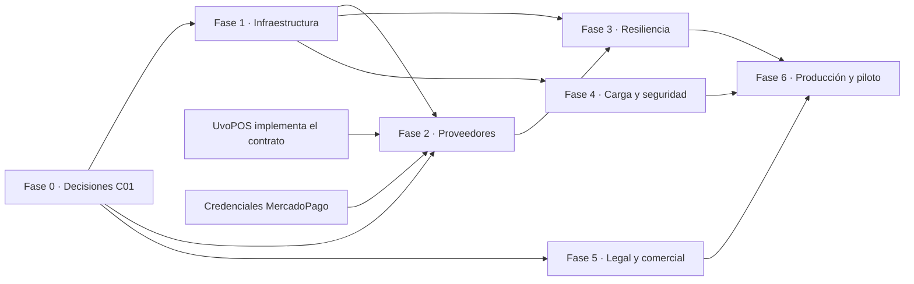

# UvoStore: evaluación de lanzamiento comercial y plan de acción

**Fecha:** 23-nov-2026 · **Base:** `main` en `d76432e` (IMP-09, PR #133), última etiqueta `v1.3.1`.

## 1. Veredicto

**UvoStore no está en condiciones de lanzarse comercialmente hoy.**

El módulo de software está prácticamente terminado:
- las brechas del informe del 30-oct (GAP-01 a GAP-20) están corregidas en código o con una decisión registrada;
- IMP-01 a IMP-09 están mergeados;
- la CI corre las pruebas de backend, el E2E sobre el artefacto final y los ensayos automáticos de servidor, recuperación y migración.

Lo que falta no es desarrollo. **Nada se ha ejecutado todavía en un ambiente real, con proveedores reales, con revisión legal y con la aprobación del responsable de la salida.** No hay staging ni producción desplegados. Todos los Cxx tienen, a lo sumo, el mecanismo y su ensayo en CI, pero ninguno tiene evidencia real ni acta.

El camino crítico no lo marca el equipo de desarrollo, sino terceros:
- el equipo UvoPOS (AlfozApi), que tiene que implementar el contrato;
- MercadoPago, que tiene que entregar las credenciales;
- la asesoría legal y contable;
- el proveedor de infraestructura (VPS, DNS, AWS, SMTP).

### 1.1 Bloqueos

| # | Bloqueo | Por qué impide vender | Fuente |
|---|---|---|---|
| B1 | No existen staging ni producción | Despliegue, HTTPS, dominios, imágenes, correo y alertas solo se ensayaron en CI con dobles (S3Mock, Mailpit) | `despliegue-backend.md`, «Evidencia por punto del checklist» |
| B2 | Documento tributario de la venta web sin decidir | El contrato POS registra la venta web solo como Boleta NT 999, que no va al SII. Falta decidir cómo se emite la boleta electrónica | `contrato-pos-ecommerce.md` §15 |
| B3 | UvoPOS no implementa el contrato | AlfozApi no tiene endpoint de máquina, ni idempotencia segura, ni stock con bloqueo, ni webhooks, ni consulta por clave. Hoy dos peticiones simultáneas pueden emitir dos veces | `contrato-pos-ecommerce.md` §13 y §14 |
| B4 | Pagos sin homologación completa | MercadoPago no tiene credenciales. Webpay solo pasó el ambiente de integración, sin staging HTTPS ni compra real en producción | `homologacion-pagos.md` §1 y §8 |
| B5 | Contenido legal sin revisión | El texto fijo de las páginas legales espera asesoría: aceptación de términos (G3), retracto, datos personales. No hay contrato con los comerciantes | `revision-legal-paginas.md` |
| B6 | Resiliencia sin ensayo real | Respaldo y restauración (C10), caídas (C18), migración y rollback (C19) y SMTP real (C11) no tienen acta | `recuperacion.md`, `despliegue-backend.md` |
| B7 | Sin pruebas de carga ni de seguridad | Faltan C20 y C21, y la parte operativa de seguridad: MFA de operadores, red privada, rotación y retención de logs | `informe-brechas-produccion-2026-10-30.md` §5 |
| B8 | Decisiones de C01 pendientes | Falta nombrar al responsable de la salida, fijar el alcance, aprobar RPO/RTO, nombrar a los custodios de llaves y a la guardia de alertas, y aprobar el contrato POS | Varios documentos remiten a C01 |

### 1.2 Lo que ya está listo (no volver a presupuestarlo)

| Área | Estado | Referencia |
|---|---|---|
| Catálogo, carrito, checkout, IVA con cupón, cambio de precio | Implementado y probado | GAP-05 (PR #105), GAP-07 (PR #107) |
| Stock, última unidad, venta multiempresa POS | Implementado con política definida | GAP-03 (PR #103), GAP-06 (PR #106) |
| Pagos: Webpay, MercadoPago, transferencia, interruptores de plataforma | Implementado; Webpay homologado en integración | IMP-07 (PR #131), `homologacion-pagos.md` |
| Reembolsos con intención, resultado incierto y resolución auditada | Implementado | GAP-01, GAP-02 |
| Outbox de POS y de correo, fallidos visibles, reintento seguro | Implementado | GAP-04 (PR #108), IMP-06 (PR #130) |
| Seguridad multi-tienda, Stripe por tienda, CSP, revocación de JWT | Implementado | GAP-11, GAP-13 (PR #116), IMP-01 |
| Configuración por ambiente sin valores por defecto peligrosos | Implementado | IMP-02, `configuracion-ambientes.md` |
| Observabilidad: Sentry, métricas, alertas probadas con promtool, runbooks | Implementado; falta conectarlo a un ambiente real | IMP-03 (PR #125), `observabilidad.md` |
| Frontend: nginx versionado, E2E sobre el `dist`, publicación atómica | Implementado | IMP-04 (PR #128), `despliegue-frontend.md` |
| Servidor: provisión, despliegue, dominio propio, verificación, ensayo en CI | Scripts listos, nunca ejecutados en un VPS | IMP-05 (PR #129), `despliegue-backend.md` |
| Contrato POS ↔ tienda | Documentado; falta implementarlo del lado POS | IMP-08 (PR #132), `contrato-pos-ecommerce.md` |
| Respaldo, restauración aislada, modo recuperación, migración y rollback | Mecanismo y ensayo en CI | IMP-09 (PR #133), `recuperacion.md` |
| Accesibilidad | Pruebas automáticas (axe) y teclado | GAP-19 (PR #119); faltan NVDA y MercadoPago sandbox |

### 1.3 Base y límites de esta evaluación

- No se leyó `GO_LIVE_CHECKLIST.md`. Los Cxx se describen según cómo los citan los documentos de `docs/`, y donde ningún documento los cubre se marcan «sin información».
- Aprobar o cerrar un Cxx le corresponde al responsable de la salida. Este documento no cierra ninguno.
- Las limitaciones de producto vienen de `guia-de-uso.md` §14 (revisión de código, no pruebas en producción).

## 2. Criterios de salida (go/no-go)

La apertura comercial se aprueba solo si se cumplen todos:

1. **Aprobaciones de C01 firmadas:** responsable de la salida, alcance, RPO/RTO, custodios, guardia y contrato POS.
2. **Staging y producción** provisionados con los scripts de `ops/`, con el informe de `verificar.sh --por-dns` archivado.
3. **Cada medio de pago** que sale tiene una compra real y un reembolso real en producción, con su acta.
4. **Una venta web de prueba** queda registrada en UvoPOS sin duplicarse, con el documento tributario emitido según lo que decidió C01.
5. **Una restauración aislada en staging** tiene su acta firmada y RPO/RTO medidos dentro de lo aprobado.
6. **Las caídas de C18 se ensayaron** sobre el proceso desplegado, sin dinero duplicado.
7. **Una alerta real** llegó a la persona de guardia, y un correo real (invitación, reset, pedido) llegó a la bandeja de entrada.
8. **La asesoría legal** aprobó las páginas legales y el contrato con el comerciante.
9. **Las pruebas de carga y seguridad** no dejaron hallazgos críticos o altos abiertos.
10. **Las limitaciones conocidas** (§3, Fase 0) están corregidas o aceptadas por escrito.

## 3. Plan por fases

Roles: **RS** responsable de la salida · **LT** líder técnico · **OPS** operaciones/infraestructura · **BE** backend ·
**FE** frontend · **QA** · **POS** equipo UvoPOS · **CONT** contabilidad · **LEG** asesoría legal · **NEG** negocio/comercial.

### Fase 0 · Decisiones (C01)

No requiere desarrollo, pero todo lo demás depende de ella.

| Tarea | Resp. | Cierra |
|---|---|---|
| Nombrar al responsable de la salida y fijar el alcance: tiendas piloto, POS encendido o no, medios de pago (Webpay, MercadoPago y transferencia, con Stripe apagado según IMP-07) | RS | C01 |
| Decidir cómo se emite el documento tributario de la venta web: desde el POS, desde un servicio aparte o por otro medio (B2) | RS + CONT + POS | C01, contrato POS §15 |
| Aprobar con contabilidad la matriz de IVA: precios con y sin IVA, cupón fijo y porcentual, envío, redondeo CLP, devoluciones | CONT | GAP-05 |
| Aprobar RPO 5 min y RTO 2 h, o fijar otros | RS | C10, `recuperacion.md` |
| Nombrar a dos custodios de llaves (`APP_ENCRYPTION_KEY`, cipher-pass de pgBackRest, IAM de respaldo) y a la guardia de cada grupo de alertas | RS | C07, C10, C17 |
| Cerrar los puntos abiertos del contrato POS (§14): bodega de `stock_web`, NTP, límites de tasa, cliente de la 999, anulación por reembolso | RS + POS | C14 |
| Decidir qué hacer con las limitaciones de `guia-de-uso.md` §14. Las de más riesgo comercial: **n.º 9**, el cobro sobre una orden cancelada, que no se puede reembolsar desde el panel; **n.º 8**, el historial invisible; **n.º 6**, que no hay consola de operador para suspender o cerrar tiendas; **n.º 1 y 2**, ajustes de envío que no hacen lo que dicen. Corregirlas o aceptarlas por escrito | RS + LT | — |
| Definir el modelo comercial: precio para el comerciante, soporte, SLA y canal de incidentes | NEG | — |

### Fase 1 · Infraestructura real (staging)

Requiere los accesos al VPS, DNS, AWS y SMTP.

| Tarea | Resp. | Evidencia | Cierra |
|---|---|---|---|
| Provisionar el VPS de staging con `provisionar.sh` y desplegar con `desplegar-backend.sh` y `publicar-frontend.sh` | OPS | Informe de `verificar.sh --reinicio`; repetirlo con otro operador | C02, C07 |
| DNS y certificados de dos tiendas y un dominio propio (`dominio-propio.sh`) | OPS | `verificar.sh --por-dns`; spoofing desde fuera | C03, C04, C05 |
| Bucket de imágenes con política y versionado, y bucket de respaldo en otra región | OPS | `verificar.sh --imagen`, antes y después de un redespliegue | C09 |
| Proveedor SMTP con SPF, DKIM y DMARC | OPS | Invitación, reset y pedido en la bandeja de entrada; ensayo de fallo (`despliegue-backend.md`, «Correo (C11)») | C11 |
| Sentry y Alertmanager con receptores humanos | OPS + LT | Tabla de evidencias de `observabilidad.md`, con las alertas disparadas a propósito | C17 |
| pgBackRest real con `instalar-respaldo.sh` y el primer respaldo completo | OPS | Métrica de último respaldo; alerta `UvoStoreRespaldoAtrasado` sin disparar | C10 |

### Fase 2 · Proveedores reales en staging

| Tarea | Resp. | Evidencia | Cierra |
|---|---|---|---|
| Obtener las credenciales de prueba de MercadoPago y correr `HOMOLOGACION=mercadopago npm run e2e:homologacion` | NEG + QA | Acta en `homologacion-pagos.md` §4 | C12 |
| Repetir la matriz de Webpay sobre staging HTTPS, con el subdominio y con un dominio propio | QA | Acta en `homologacion-pagos.md` §3 | C12 |
| Ensayar el procedimiento de transferencia con negocio | NEG | `homologacion-pagos.md` §5 | C12 |
| UvoPOS implementa el contrato IMP-08: endpoint de máquina, idempotencia por empresa, folio único, stock con bloqueo, webhooks firmados, llaves por empresa, consulta por clave y snapshot | POS | Pruebas compartidas del contrato contra base descartable | C14 |
| Conectar la tienda con UvoPOS en staging. Con la consulta por clave lista, el informe de recuperación deja de dar `INCIERTO_POS` | BE + POS | Venta web registrada una sola vez; conciliación sin divergencias | C14 |
| E2E y recorrido completo sobre staging HTTPS con proveedores reales | QA | Informe del recorrido (`despliegue-frontend.md`) | C16 |
| Pruebas manuales pendientes de GAP-19: NVDA y MercadoPago sandbox | QA | `pruebas-manuales-gap-19.md` | — |

### Fase 3 · Resiliencia en staging

Depende de las fases 1 y 2.

| Tarea | Resp. | Evidencia | Cierra |
|---|---|---|---|
| Restauración aislada con `restaurar.sh`, con la llave traída del gestor por un custodio | OPS + custodio | Acta de `recuperacion.md` firmada, RPO/RTO medidos | C10 |
| Corte de red durante el commit de Webpay y durante una devolución; reinicio entre la operación externa y el registro local | QA + BE | Informe de recuperación sin dinero duplicado (`homologacion-pagos.md` §8, punto 4) | C18 |
| Migración y rollback sobre una copia representativa de staging, coordinados con el equipo POS porque el clúster es compartido | OPS + POS | Clasificación de `migracion-rollback` repetida en staging | C19 |

### Fase 4 · Carga y seguridad

Puede empezar al terminar la fase 1.

| Tarea | Resp. | Evidencia | Cierra |
|---|---|---|---|
| Definir los objetivos de carga (tiendas, compradores concurrentes, latencia p95) y probarlos con **una sola réplica** (GAP-12: la revocación JWT y los límites usan caché de proceso) | LT + QA | Informe de carga | C20 |
| Pentest externo de la tienda, el panel, la API de plataforma y la API del POS; revisión de dependencias | Externo + LT | Informe sin críticos ni altos abiertos | C21 |
| Seguridad operativa: MFA de operadores, acceso al servidor solo por red privada o bastión, rotación de secretos, retención de auditoría y logs | OPS | Procedimiento escrito y ensayado | GAP-13 (operativo) |

### Fase 5 · Legal y comercial

En paralelo desde el inicio.

| Tarea | Resp. | Cierra |
|---|---|---|
| Revisión de `revision-legal-paginas.md` por la asesoría: textos fijos, casilla de aceptación (G3), exclusiones de retracto (D5) | LEG | GAP-18 |
| Cumplimiento de la Ley 19.496 en comercio electrónico: información previa, retracto y garantía | LEG | — |
| Protección de datos personales: Ley 19.628 y Ley 21.719 (la asesoría confirma la vigencia y sus obligaciones), política de privacidad, encargo de tratamiento | LEG | — |
| Contrato de servicio con cada comerciante: responsabilidades, datos, disponibilidad y soporte | LEG + NEG | — |
| Proceso comercial y de soporte: alta de tiendas (hoy solo por la API de plataforma), cobro al comerciante, mesa de ayuda | NEG + LT | — |

### Fase 6 · Producción y salida controlada

Depende de todas las anteriores.

| Tarea | Resp. | Evidencia |
|---|---|---|
| Provisionar producción con los mismos scripts y verificarla | OPS | `verificar.sh --por-dns` en producción |
| Compra controlada real en Webpay y MercadoPago, con su reembolso y custodios de credenciales | RS + QA | Acta en `homologacion-pagos.md` |
| Piloto con una o dos tiendas reales, con POS si C01 lo incluye | RS + NEG | Ventas, conciliación y documentos tributarios cuadrados |
| Hipercuidado de dos a cuatro semanas: guardia activa, revisión diaria de outbox, conciliación y alertas, con criterio de rollback según `recuperacion.md` | OPS + LT | Bitácora del piloto |
| Decisión go/no-go con los criterios de §2 y apertura comercial | RS | Acta de salida |

## 4. Camino crítico

- Lo más largo es probablemente la implementación del contrato del lado de UvoPOS, que tiene 9 brechas en AlfozApi (§13 del contrato) y depende de otro equipo. **Si C01 decide salir sin POS**, el piloto no espera ese trabajo, pero el documento tributario (B2) debe resolverse igual por otro medio.
- Las fases 1, 2 y 5 avanzan en paralelo una vez tomadas las decisiones de la fase 0.
- No se dan plazos en días: casi todo depende de terceros. El trabajo de desarrollo que queda (las limitaciones de §14 que se decida corregir y los ajustes que salgan de los ensayos) se estima cuando C01 fije el alcance.

## 5. Riesgos de la salida

| Riesgo | Efecto | Mitigación |
|---|---|---|
| UvoPOS se demora en implementar el contrato | Sin venta web registrada en el POS; stock web sin bloqueo | Decidir en C01 si el piloto sale sin POS; mantener `POS_ENABLED` según C01 |
| Documento tributario sin resolver | Ventas sin boleta ante el SII | Bloqueo explícito del go/no-go (§2, punto 4) |
| MercadoPago sin credenciales a tiempo | C12 no se cierra | Salir solo con Webpay y transferencia, con `MERCADOPAGO_ENABLED=false`, si C01 lo aprueba |
| Clúster PostgreSQL compartido con UvoPOS | Restaurarlo devuelve también la base del POS al mismo punto | Restaurar siempre en aislado y coordinar con el equipo POS (`recuperacion.md`) |
| Una sola réplica (GAP-12) | Sin alta disponibilidad: un reinicio es una caída breve | Ventana de despliegue avisada; RTO aprobado en C01; estado compartido si la carga lo exige |
| Confundir el ensayo de CI con evidencia real | Cxx cerrados sin probar en el ambiente objetivo | Cada Cxx exige el acta del ambiente real (§6) |
| Guardia sin responsable | Alertas que nadie atiende | Guardia nominal en C01 y prueba de recepción (C17) |
| Limitaciones del panel (n.º 8 y 9 de §14) | Cobros sobre órdenes canceladas resueltos fuera del panel; soporte más costoso | Corregirlas antes del piloto o documentar el procedimiento manual |

## 6. Seguimiento por punto del checklist

Estado según los documentos de evidencia al 23-nov-2026. «Mecanismo listo» significa que existen el código, los scripts y su ensayo en CI, pero falta la evidencia del ambiente real.

| Punto | Tema (según `docs/`) | Estado | Documento | Qué lo cierra |
|---|---|---|---|---|
| C01 | Decisiones y aprobaciones del responsable | Abierto | Varios | Fase 0 |
| C02 | Staging desde instrucciones, artefactos identificados | Mecanismo listo | `despliegue-backend.md` | Fase 1 |
| C03 | Dos tiendas HTTPS, dominio propio, hosts desconocidos | Mecanismo listo | `despliegue-backend.md` | Fase 1 |
| C04 | Host preservado, proxies de confianza, spoofing | Mecanismo listo | `despliegue-backend.md` | Fase 1 |
| C05 | Caché por host, SPA recargable | Mecanismo listo | `despliegue-backend.md`, `despliegue-frontend.md` | Fase 1 |
| C06 | — | Sin información | — | Revisar en el checklist |
| C07 | Ambiente, secretos, roles, custodia de la llave | Mecanismo listo | `despliegue-backend.md`, `recuperacion.md` | Fases 0 y 1 |
| C08 | Configuración por ambiente | Mecanismo listo | `configuracion-ambientes.md` | Fase 1 |
| C09 | Imágenes persistentes y URL https | Mecanismo listo | `despliegue-backend.md` | Fase 1 |
| C10 | Respaldo, custodia, restauración con RPO/RTO | Mecanismo listo | `recuperacion.md` | Fases 0, 1 y 3 |
| C11 | Correo real, remitente autenticado, fallo recuperable | Mecanismo listo | `despliegue-backend.md` | Fase 1 |
| C12 | Pasarelas con credenciales y callbacks reales | Parcial (Webpay en integración) | `homologacion-pagos.md` | Fases 2 y 6 |
| C13 | — | Sin información | — | Revisar en el checklist |
| C14 | Integración POS | Abierto (contrato sin implementar) | `contrato-pos-ecommerce.md` | Fase 2 |
| C15 | Superficies diferidas apagadas fuera de dev | Mecanismo listo | `configuracion-ambientes.md` | Verificar en staging y producción |
| C16 | Recorrido completo en staging HTTPS | Mecanismo listo (E2E sobre el `dist`) | `despliegue-frontend.md` | Fase 2 |
| C17 | Eventos y alertas reales del ambiente | Mecanismo listo | `observabilidad.md` | Fase 1 |
| C18 | Caídas durante pago, outbox y devolución | Mecanismo listo | `recuperacion.md`, `homologacion-pagos.md` | Fase 3 |
| C19 | Migración y rollback, coherencia con el POS | Mecanismo listo | `recuperacion.md` | Fase 3 |
| C20 | Pruebas de carga | Abierto | — | Fase 4 |
| C21 | Pruebas de seguridad | Abierto | — | Fase 4 |
